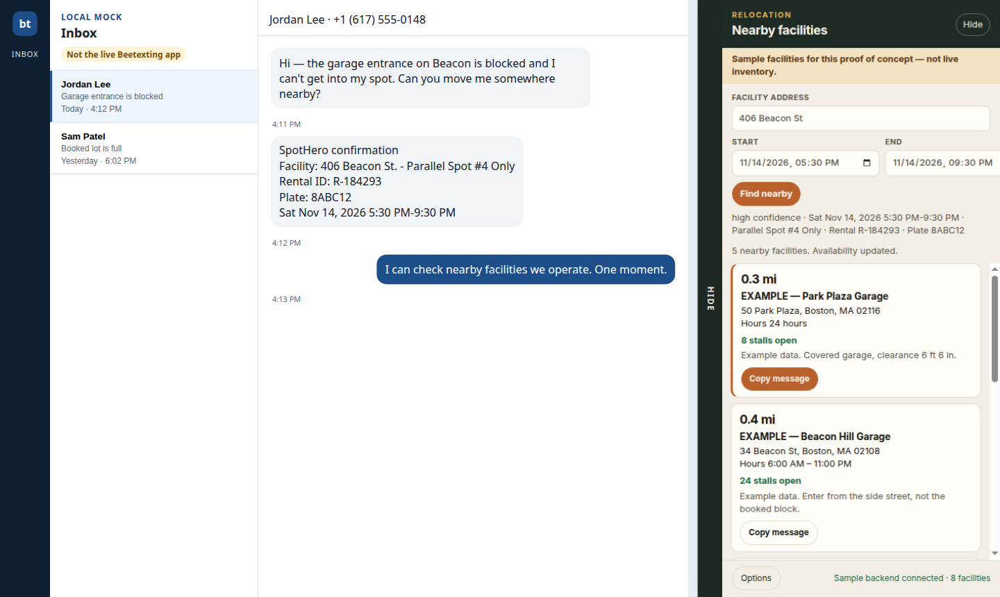

# Nearby relocation panel

Proof of concept for YourSpotRented support agents. When a customer cannot park at the facility on their SpotHero booking, the agent sees nearby facilities we manage without leaving the [Beetexting](https://app.beetexting.com) conversation.

Beetexting does not offer a custom sidebar, and the [public API](https://developer.beetexting.com/) cannot read the open conversation or write a thread note. This extension reads the booking from the page and asks a small backend for options.

The committed facility list is **fictional sample data**. Do not put real inventory, customer messages, or credentials in this public repo.



## What it does

1. A content script on `https://app.beetexting.com/*` watches the inbox (including single-page navigation) and reads the open thread.
2. It looks for a facility address and a booking window. The sample shape is `406 Beacon St. - Parallel Spot #4 Only` and `Sat Nov 14, 2026 5:30 PM-9:30 PM`.
3. A collapsible panel on the right, rendered as an extension page inside an iframe (`web_accessible_resources`), calls the backend.
4. `GET /nearby` returns the closest managed facilities in well under a second. Stall counts stream in afterward from a pluggable availability provider. The provider shipped here is a mock with a short cache.
5. Each row has a **Copy message** button with a text the agent can paste back to the customer.

If detection is wrong, the address and start/end fields in the panel are the fallback. They are always editable.

The Chrome toolbar icon opens the same UI in the side panel. The in-page panel is the one that stays beside the thread.

For the sample booking at 406 Beacon St, the nearest example facilities are Park Plaza Garage (about 0.3 mi), Beacon Hill Garage, and Clarendon Lot. A deliberately closer “private lot” is marked unmanaged and is not offered.

## Project layout

| Path | Role |
| --- | --- |
| `extension/` | Manifest V3 extension. Load this folder unpacked. |
| `extension/lib/` | Text extraction, distance ranking, and settings. Shared with the Node tests and backend. |
| `backend/` | TypeScript service: nearby search, geocode cache, availability, Airtable import. |
| `backend/data/*.example.json` | Fictional facilities and geocodes. Safe to commit. |
| `mock/` | Local page shaped like an inbox, for trying the extension without a Beetexting login. |
| `test/` | Distance ranking and booking-text extraction. |

## Run it locally

Requirements: Node 20+ and Chrome 114+.

```bash
npm install
npm test
npm run demo
```

`npm run demo` starts both processes. Or run them separately:

```bash
npm start          # backend on http://127.0.0.1:8787
npm run mock       # inbox on http://127.0.0.1:4173
```

Load the extension:

1. Open `chrome://extensions`.
2. Turn on **Developer mode**.
3. **Load unpacked** and choose the `extension` directory.
4. Open http://127.0.0.1:4173/.

The panel should open on the right with the Beacon Street booking filled in and a ranked list beneath it. Click **Sam Patel** to switch threads; the panel should pick up 75 State St. Collapse the panel with **Hide** or the vertical tab. The extension icon opens the side panel.

`http://127.0.0.1:4173/heuristic.html` omits the configured selectors on purpose. The open thread is still detected from the visible text, and an address sitting in the aside is ignored.

## Options

Right-click the extension icon and choose **Options**, or use **Options** in the panel footer.

| Setting | Purpose |
| --- | --- |
| Backend URL | Default `http://127.0.0.1:8787`. No API key is stored in the extension. |
| Results to show | 1–20. Default 5. |
| Conversation selectors | Comma-separated CSS. A bad selector is skipped. |
| Log detection details | Prints the extracted booking to the page console. Use this while checking a real inbox. |

Default selectors match the mock page (`[data-ysr-conversation]`, `[data-ysr-message]`, and so on). They are **not** verified against a logged-in Beetexting DOM. On the live app the content script falls back to visible text that looks like a booking, outside `nav` and `aside`. Confirm real selectors before relying on that.

**Test connection** calls `GET /health`.

## Backend

```bash
curl 'http://127.0.0.1:8787/nearby?address=406%20Beacon%20St&start=2026-11-14T17:30&end=2026-11-14T21:30'
curl 'http://127.0.0.1:8787/availability?ids=ex-park-plaza,ex-beacon-hill&start=2026-11-14T17:30&end=2026-11-14T21:30'
```

`/nearby` only ranks. It does not wait on availability, so the panel can paint distance immediately. `/availability/stream` then emits one Server-Sent Event per facility as the parallel checks finish. `/availability` returns the same payload as JSON. `/api/nearby` and `/api/availability` are aliases.

Times are facility-local wall times (`2026-11-14T17:30`), not UTC instants.

Unknown addresses return 422 unless `GEOCODER=nominatim`. Nominatim results are written to `backend/data/geocode-cache.json`, which is gitignored. The sample conversations resolve from `geocode-cache.example.json` with no network.

### Environment

Copy `.env.example` to `.env`. The interesting knobs:

| Variable | Default | Meaning |
| --- | --- | --- |
| `FACILITIES_PATH` | `backend/data/facilities.example.json` | Catalog to load. Point this at the import output for real data. |
| `GEOCODER` | `cache` | `cache` or `nominatim`. |
| `AVAILABILITY_PROVIDER` | `mock` | `spothero` fails on purpose until that provider exists. |
| `AVAILABILITY_TTL_MS` | `30000` | Repeat checks inside the window are served from memory. |
| `AVAILABILITY_DELAY_MS` | `120` | Artificial mock latency. Set `0` in tests. |
| `NEARBY_LIMIT` | `5` | Used when the request omits `limit`. |

The availability provider interface is `check({ facilityId, start, end })` in `backend/src/availability.ts`. A SpotHero implementation should return the same `{ status, stallsAvailable, note }` shape. The HTTP layer already fans those checks out in parallel and caches them.

Facilities with `managed: false`, or without coordinates, are not offered. A result within about 0.05 miles of the booked pin is labeled as the same location and sorted after real alternatives.

## Airtable import

The import reads whatever base you point at. It does not ship with a token, a base id, or a copy of internal inventory.

Expected columns (rename them with the `AIRTABLE_FIELD_*` variables):

| Column | Use |
| --- | --- |
| Name | Facility name |
| Address | Street address. Geocoded when latitude or longitude is empty. |
| Latitude, Longitude | Optional if you geocode. |
| Stalls | Capacity. The mock provider will not report more open stalls than this. |
| Hours, Notes | Shown on the card. |
| Managed | Checkbox or yes/no. Rows that are explicitly false are skipped. A missing value is treated as managed. |

```bash
cp .env.example .env
# fill AIRTABLE_TOKEN, AIRTABLE_BASE_ID, and AIRTABLE_TABLE
npm run import:airtable -- --dry-run
npm run import:airtable
```

Output defaults to `backend/data/facilities.json`. That path is gitignored. The script refuses to write a file git would track, and it refuses to overwrite an `*.example.json` file. Set `FACILITIES_PATH` to the output and restart the backend.

With `GEOCODER=cache`, rows that still have no coordinates are skipped and printed. Set `GEOCODER=nominatim` to look each one up once. Use a real `NOMINATIM_EMAIL` and respect the [Nominatim usage policy](https://operations.osmfoundation.org/policies/nominatim/). Lookups are serialized about once a second and then cached.

## Tests

```bash
npm test
npm run typecheck
```

The Node tests cover haversine distance, relocation ranking (including “do not suggest the unmanaged lot on top of the booking”), booking-text extraction, the sample geocode cache, and the HTTP ranking, cache, and event stream.

`npm run screenshot` reloads the unpacked extension against the mock inbox and writes `docs/panel-on-mock-page.png`. It needs `npm run demo` already running, and a Chromium build that still honors `--load-extension` (`CHROME_PATH`). Current branded Google Chrome ignores that switch.

## Next steps

**Selector verification.** Sign in to a Beetexting inbox, turn on **Log detection details**, and open a real thread that contains a facility and a time window. If the manual box is empty or wrong, inspect the message nodes and paste those selectors into Options. Keep the manual box either way.

**SpotHero availability.** Add a provider next to `MockAvailabilityProvider` that maps our facility id to a SpotHero facility and checks the booking window. Leave `AVAILABILITY_PROVIDER=mock` as the default until that client is reviewed. Do not put SpotHero credentials in the extension; they belong in the backend environment.

**Hosting.** Run the backend where agents’ browsers can reach it, bind it to more than localhost only behind a firewall or a private network, and restrict CORS instead of `*`. Point the extension’s backend URL at that host. The extension still must not contain a secret. If the API needs a credential, terminate it at the network layer rather than shipping a token inside the extension package.

**Google Workspace force-install.** Package the extension for the Chrome Web Store as private/unlisted, or host the CRX for the enterprise policy. In the Admin console, set `ExtensionInstallForcelist` for the support OU. Before that build, remove the `127.0.0.1:4173` and `localhost:4173` content-script matches and narrow `host_permissions` to `https://app.beetexting.com/*` plus the production backend origin. Page CSP can still block extension iframes; the side panel is the fallback if an inbox ships a `frame-src` policy that excludes `chrome-extension:`.

## Public-repo rules

- `.env` is gitignored. `.env.example` has empty secrets.
- `backend/data/facilities.json` and `backend/data/geocode-cache.json` are gitignored. Only the `*.example.json` files are committed.
- Example facility names start with `EXAMPLE`. The copy-message helper strips that prefix so a demo text is readable; the card still shows it, and the panel banner says the list is not live inventory.
- Do not paste real customer threads into issues or fixtures.
